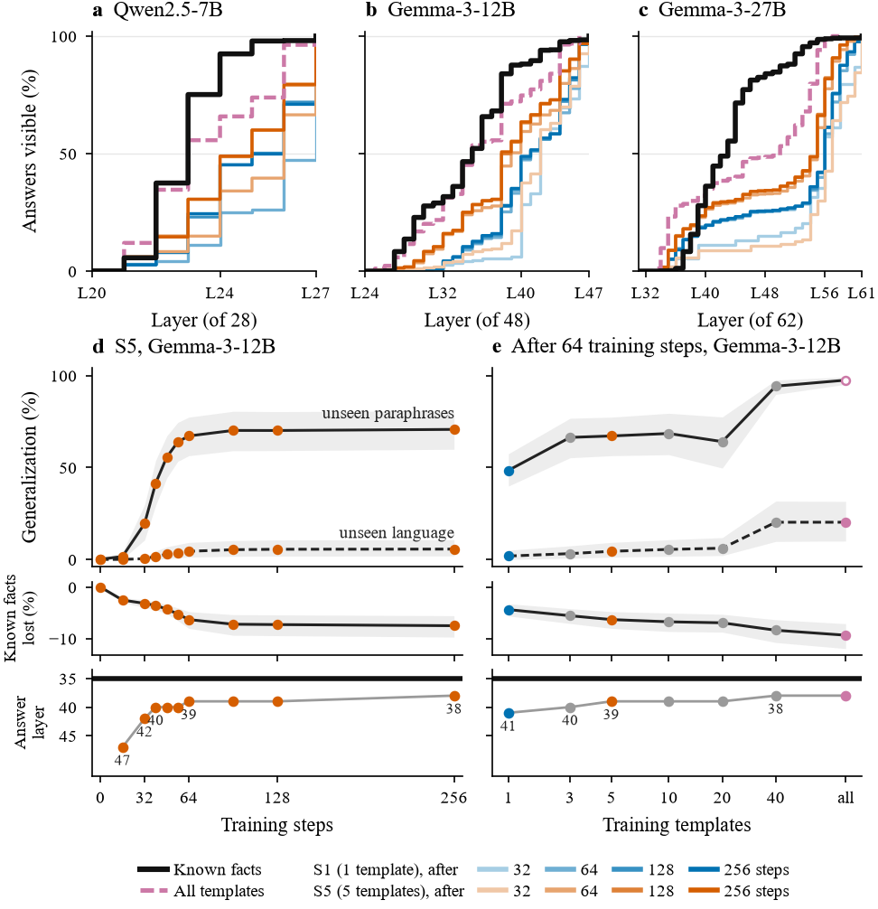
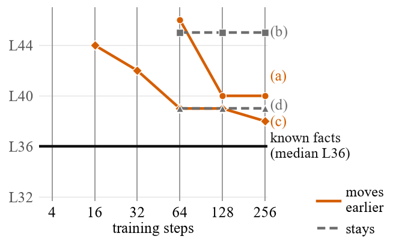
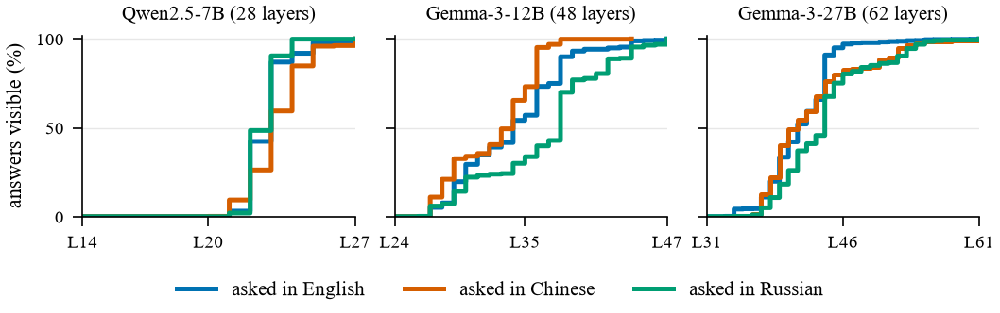
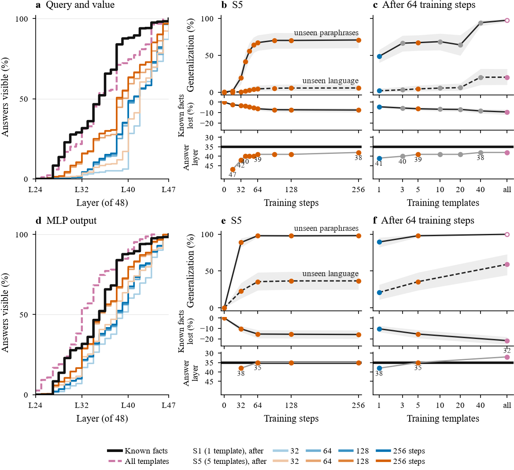
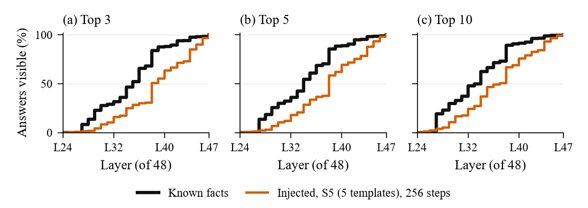

<div align="center">

# 🧭 From one example to pretraining 📚

## How supervision moves the depth at which facts become readable in LLMs

Francesco Mantovani ⋅ Alexis Huet ⋅ Giulio Franzese ⋅ Pietro Michiardi ⋅ Dario Rossi ⋅ Zied Ben Houidi

**Accepted at UniReps 2026** (Workshop on Unifying Representations in Neural Models, Extended Abstract track)

[](https://openreview.net/forum?id=LLlkI2C6FX) [](LICENSE) [](requirements.txt)

#### Do injected facts become readable at the same depth as facts learned in pretraining, and does more supervision move them there?



<sub><b>Figure 1.</b> Supervision moves injected facts toward the depth of known facts. (a–c) Share of correct answers already readable at each layer; trained and tested in the second language, 30 facts. Black: known facts; blue, orange: S1, S5 (1 or 5 training templates), darker with more steps; dashed: all templates. (d, e) Gemma-3-12B, five sentences over training steps (d) and after 64 steps over training templates (e): generalization to unseen paraphrases (solid) and to the unseen language (dashed), known facts lost, and median answer layer (black line: known facts).</sub>

</div>

Tell a person that *"Zhuang Fenghui was born in London"*, and they can answer the same question in other words or in
another language they speak. Fine-tune a language model on it, and it often cannot, while facts acquired in pretraining
are retrieved from almost any phrasing. The usual fix is to train on many paraphrases of each fact. We ask what those
paraphrases change inside the model, and focus on one candidate: **the depth at which the fact becomes readable**.

- 📍 **Q1: depth.** In all three models, facts injected with little supervision (few paraphrases, few steps) become
  readable **later** than known facts: from about 3 layers later in Qwen2.5-7B (in Russian only) to **13 layers** in Gemma-3-27B.
  More supervision moves them earlier, and with all templates they reach known facts in Qwen2.5-7B and Gemma-3-12B.
- 🌐 **Q2: generalization.** It grows with supervision, but it does not wait for the answer layer. In Gemma-3-27B,
  five Chinese sentences answer **96%** of unseen Chinese paraphrases while the fact is still read **14 layers** after
  known facts. Across languages, transfer stays rare: from Chinese, at most **14%** even with all templates.
- 🔤 **Where the gap lies.** It lies in the **English name** of the answer. Known facts reach it in the middle layers
  and injected facts reach it later, while the Chinese or Russian name appears late for both.

---

## 🔎 Problem definition

For a prompt the model answers correctly, a **Jacobian lens** (J-lens; [Gurnee et al., 2026](https://transformer-circuits.pub/2026/workspace/index.html))
reads, at every layer, which tokens that layer already predicts at the last prompt token. The **answer layer** is the
first layer at which a first token of the correct city (its English or its native name, e.g. "Toronto" or 多伦多) is
among the lens's **top 3** tokens.

We compare the answer layer of three kinds of facts:

| Facts | What | Supervision |
|---|---|---|
| **Known (K)** | Real people the untouched model already answers correctly | Pretraining: many phrasings, many times |
| **Injected, S1 / S5** | Fictional people, trained with LoRA | 1 or 5 paraphrases, 32 to 256 steps |
| **Injected, all** | Same | Every paraphrase of the relation |

---

## 🧪 Setup

**Prompts.** MyriadLAMA (Zhao et al., 2024) gives many paraphrased
templates per relation. We keep the English templates that end where the city should come, either questions
(*"Where was [X] born?"*) or incomplete sentences (*"[X] was born in the city of"*). That gives **86** for place of birth,
**54** for place of death and **87** for work location. Claude Haiku 4.5 translated them into **Chinese** and
**Russian**, template by template. Both languages use another script, so the name, the question and the answer are
all written with different tokens.

**Fictional people.** Ten invented people, five with Chinese names and five with Russian names, written in both
scripts. Each person has one city for all three relations: **30 facts**, e.g. Zhuang Fenghui (庄风辉) was born, died and
worked in London. Before injection, the models name their city in at most 3 of the 4,540 prompts.

**Injection.** One LoRA adapter per fact: rank 8, α 16, on the attention query and value projections, AdamW,
lr 2·10⁻⁵, seed 0. One batch holds all training sentences, and the loss is on the answer tokens only. Training runs for
up to 256 steps, with tests after 32, 64, 128 and 256. The models are **Qwen2.5-7B, Gemma-3-12B and Gemma-3-27B** (28, 48 and 62 layers).
The main run is 3 models × 30 facts × training language {English, second language} × {S1, S5, all} = **540 runs**.

**Evaluation.** Greedy decoding, 32 new tokens, no chat template. An answer is correct if it names the city and the judge
agrees (rules first, GPT-4o-mini for the rest). **Known facts lost** is the share of known-fact prompts answered
correctly before injection and wrongly after.

<div align="center">

</div>

<sub><b>Figure 2.</b> Four single prompts across training. Answer layer of four unseen Chinese prompts from their first correct step; Gemma-3-12B trained in Chinese on three sentences. Their English templates: (a) "Duan Kexin commenced living in", (b) "Where did Gan Meizhi first see the light of day?", (c) "Zhuang Fenghui was introduced to the world in", (d) "What city claims the birth of Zhuang Fenghui?". Black: known facts (median).</sub>

---

## 🔬 Appendix figures

<div align="center">

</div>

<sub><b>Figure 3.</b> Known facts, pooled over relations, untouched models, read as Figure 1: asked in English (blue), Chinese (orange) and Russian (green).</sub>

<div align="center">

</div>

<sub><b>Figure 4.</b> Where the adapter sits, Gemma-3-12B. Top: adapter on the attention query and value projections (main text); bottom: on the MLP output projection. Moving the adapter to the MLP brings both the answer layer and transfer closer to known facts, at the cost of more forgetting.</sub>

<div align="center">

</div>

<sub><b>Figure 5.</b> The top-k rule (top 3, 5 or 10), Gemma-3-12B, S5, trained and tested in the second language, 256 steps.</sub>

---

## 🛠️ Reproducing the paper

**All the code to reproduce every figure, table and number of the paper and appendix.** It runs in two steps:

1. **GPU.** Each experiment is one YAML file in [`experiments/configs/`](experiments/configs/), run by one command.
   It writes its results (raw JSON, one file per checkpoint) to `results/<experiment>/`. The runs are resumable:
   whatever is on disk is skipped.
2. **No GPU.** Each notebook reads those results and draws one part of the paper. It also prints the numbers the
   paper cites.

**The notebooks are saved with their outputs**, computed from the paper's own result files, so every figure and number
can be read without running anything. Rerunning the configs gives the same results; see
[Checking a reproduction](#checking-a-reproduction).

| Paper | Content | Notebook (no GPU) | GPU: experiment → `results/` |
|---|---|---|---|
| Sec. 2, App. A | Untouched models: invented people unknown, known facts known | [`main/1_dataset_sanity`](experiments/main/1_dataset_sanity.ipynb) | `main` |
| Fig. 1, Sec. 3 | Answer layer, generalization, forgetting; every number in the text | [`main/fig1_answer_layer`](experiments/main/fig1_answer_layer.ipynb) | `main`, `fig1` |
| Fig. 2 | Four single prompts across training | [`main/fig2_single_prompts`](experiments/main/fig2_single_prompts.ipynb) | `lr_sweep` |
| Tab. 1–3, Fig. 3 | Templates, invented people, known facts | [`appendix/A_dataset`](experiments/appendix/A_dataset.ipynb) | `main` |
| App. B.2 | Learning rate, known facts lost | [`appendix/B2_learning_rate`](experiments/appendix/B2_learning_rate.ipynb) | `lr_sweep`, `main` |
| Fig. 4, App. B.3 | Adapter on the MLP output | [`appendix/B3_adapter_site`](experiments/appendix/B3_adapter_site.ipynb) | `main`, `fig1`, `mlp_out`, `mlp_hidden` |
| Fig. 5, App. C.3 | Top-3 / 5 / 10 | [`appendix/C3_topk`](experiments/appendix/C3_topk.ipynb) | `main` |
| Tab. 4, App. C.4 | Refitted J-lens, lens agreement | [`appendix/C4_lens_refit`](experiments/appendix/C4_lens_refit.ipynb) | `lr_sweep`, then `lens_refit` |
| Tab. 5, App. C.5 | English vs native name of the city; prompts across training | [`appendix/C5_spelling`](experiments/appendix/C5_spelling.ipynb) | `main` |
| Tab. 6, App. C.6 | Known facts read with each adapter on | [`appendix/C6_known_on_finetuned`](experiments/appendix/C6_known_on_finetuned.ipynb) | `main`, then `known_ft` |

### The experiments

| Config | What | Runs | Time (one GPU) |
|---|---|---|---|
| [`main.yaml`](experiments/configs/main.yaml) | 3 models × 30 facts × {EN, 2nd language} × {S1, S5, all}, checkpoints 32–256; saves the 256-step adapters | 540 | several days |
| [`fig1.yaml`](experiments/configs/fig1.yaml) | Gemma-3-12B, extra checkpoints (16–96) and sizes (3, 10, 20, 40) | 210 | about 1 day |
| [`mlp_out.yaml`](experiments/configs/mlp_out.yaml), [`mlp_hidden.yaml`](experiments/configs/mlp_hidden.yaml) | Gemma-3-12B, the adapter on the MLP output / hidden layer | 90 + 90 | about 4 h each |
| [`lr_sweep.yaml`](experiments/configs/lr_sweep.yaml) | 3 models, 4 learning rates, 3 facts, S1 / S3 / all, checkpoints 4–256, stop at 25% of known facts lost; saves the adapters | 216 | about 1 day |
| [`lens_refit.yaml`](experiments/configs/lens_refit.yaml) | Two J-lenses fitted again (untouched / with one adapter of the sweep), their readout and agreement | – | about 10 h |
| [`known_ft.yaml`](experiments/configs/known_ft.yaml) | The known facts read with each adapter of `main` on | 270 | about 6 h |

```bash
python -m factdepth.run        experiments/configs/main.yaml        # main, fig1, mlp_out, mlp_hidden, lr_sweep
python -m factdepth.lens_refit experiments/configs/lens_refit.yaml  # after lr_sweep
python -m factdepth.known_ft   experiments/configs/known_ft.yaml    # after main
```

The judge needs `OPENROUTER_API_KEY` (GPT-4o-mini, a few dollars in all). Without a key, `--judge none` takes the
pattern match instead of the LLM for the answers the rules cannot decide. The injected facts then come out within
about 0.5 points of the paper, but forgetting comes out about 2 points lower: some answers name the right city and
then go on with invented text, and the LLM judge counts them wrong.

### Checking a reproduction

`--reference` compares every result file with another run of the same experiment (e.g. an earlier run of yours, or one
on another machine): training losses, every answer,
J-lens ranks and top-10 tokens, verdicts, known facts after, drop. Training, greedy decoding and the readout are
deterministic, so they must be identical. The LLM judge is not, so `judge: reuse` gives identical answers the
reference's verdicts.

```bash
export FACTDEPTH_REFERENCE=/path/to/reference/results     # laid out like results/, read as paper:<experiment>
python -m factdepth.run experiments/configs/check_main.yaml        # 3 models, EN- and 2nd-language-trained, ~3 h
python -m factdepth.run experiments/configs/check_gemma12b_s1.yaml # ~1 h
python -m factdepth.run experiments/configs/check_mlp_out.yaml     # ~30 min
python -m factdepth.run experiments/configs/check_lr_sweep.yaml    # Fig. 2 setting + one stopped run, ~1 h
python -m factdepth.run CONFIG --regrade --judge reuse --reference paper:main   # no GPU: grade existing files again
```

| Checked | Result |
|---|---|
| Gemma-3-12B, 30 facts, 2nd language, S1 / S5 / all, checkpoints 16–256 ([`reproduce_gemma12b.yaml`](experiments/configs/reproduce_gemma12b.yaml), 510 files) | identical: every loss, answer (77,180 injected, 231,540 known), J-lens rank, verdict, drop |
| The learning-rate sweep's files, graded again with this code | identical verdicts and drop |
| Qwen2.5-7B, 2 facts, trained in the 2nd language and in English, S5 ([`check_main.yaml`](experiments/configs/check_main.yaml)) | identical |
| Gemma-3-27B, 1 fact, 2nd language, S5, 32 steps | identical |
| MLP adapter, App. B.3 ([`check_mlp_out.yaml`](experiments/configs/check_mlp_out.yaml)) | identical |
| Learning-rate sweep, Fig. 2 setting + one run stopped by the 25% rule ([`check_lr_sweep.yaml`](experiments/configs/check_lr_sweep.yaml)) | identical |
| App. C.6 (`known_ft.py`), 5 of the paper's adapters | identical J-lens ranks (1,040 prompts) |

---

## 📁 Repository structure

```
├── data/
│   ├── templates/              # paraphrase templates per relation, in English, Chinese and Russian (see below)
│   ├── injected/               # the 10 fictional people: prompts, gold names, training splits
│   ├── known_facts/            # each model's 3 real people and the untouched model's answers
│   └── lr_sweep/               # the learning-rate sweep's facts (with two-hop questions) and known facts
├── src/factdepth/
│   ├── config.py               # every fixed setting: models, lenses, LoRA sites, grids, result folders
│   ├── data.py                 # the dataset: units, prompts, training sentences
│   ├── model.py  lens.py       # loading, greedy generation; the J-lens readout
│   ├── inject.py               # LoRA training, evaluated at every checkpoint
│   ├── evaluate.py             # answers, readout, judge, known facts after, forgetting
│   ├── judge.py  llm.py        # the answer judge (v5; v1 for the learning-rate sweep), GPT-4o-mini via OpenRouter
│   ├── matching.py             # does an answer name the city (English / Chinese / Russian rules)
│   ├── run.py                  # the GPU entry point of the injections: python -m factdepth.run <config.yaml>
│   ├── lens_refit.py           # App. C.4: J-lenses fitted again, their readout and agreement
│   ├── known_ft.py             # App. C.6: the known facts read with each adapter on
│   └── analysis/               # metrics.py (the measures), plots.py (figures), tables.py, numbers.py (in-text numbers)
├── experiments/
│   ├── configs/                # one YAML per GPU experiment (+ check_*.yaml: comparisons with the paper's files)
│   ├── main/                   # notebooks of the main text
│   └── appendix/               # notebooks of the appendix
├── results/                    # what the configs write (not in git), what the notebooks read
├── figures/                    # Paper figures (PDF), written by the notebooks
│   └── png/                    # PNG renders used in this README
├── .env.example                # API keys template
└── requirements.txt            # Pinned versions of the paper's environment
```

---

## ⚙️ Setup

Python 3.12. The paper's environment was Python 3.12.13 with the CUDA 12.6 torch wheels. This is given for
information only, not as a requirement.

```bash
python3.12 -m venv .venv && source .venv/bin/activate
pip install -r requirements.txt
cp .env.example .env            # then fill in HF_TOKEN (Gemma is gated) and OPENROUTER_API_KEY (the judge)
```

Gemma-3-27B needs about 66 GB of GPU memory, and the other two models need less.

**Offline GPU nodes.** Download the models and lenses where there is internet, with the same `HF_HOME`
(`huggingface-cli download <repo id>`), then set `HF_HUB_OFFLINE=1` on the node. The judge needs internet: answers can be
judged elsewhere afterwards.

**Exact revisions** of the models and lenses used in the paper:

| Model | HF revision | Layers | Jacobian lens (HF repo @ revision) |
|---|---|---|---|
| [`Qwen/Qwen2.5-7B-Instruct`](https://huggingface.co/Qwen/Qwen2.5-7B-Instruct) | `a09a3545` | 28 | [`anicka/jlens-qwen2.5-7b-instruct`](https://huggingface.co/anicka/jlens-qwen2.5-7b-instruct) @ `40efacc7` |
| [`google/gemma-3-12b-it`](https://huggingface.co/google/gemma-3-12b-it) | `96b6f1ec` | 48 | [`neuronpedia/jacobian-lens`](https://huggingface.co/neuronpedia/jacobian-lens) @ `b25d72a9` |
| [`google/gemma-3-27b-it`](https://huggingface.co/google/gemma-3-27b-it) | `005ad340` | 62 | [`neuronpedia/jacobian-lens`](https://huggingface.co/neuronpedia/jacobian-lens) @ `b25d72a9` |

App. C.4 fits two lenses on WikiText-103 ([`Salesforce/wikitext`](https://huggingface.co/datasets/Salesforce/wikitext),
`wikitext-103-raw-v1`, first train shard), downloaded on first use or read from a local copy (`wikitext:` in
[`lens_refit.yaml`](experiments/configs/lens_refit.yaml)).

---

## 📚 Dataset

Everything is in [`data/`](data/), in plain JSON (17 MB). Nothing needs to be regenerated, and no API key is needed to
read it.

```
data/
├── templates/                  # P19_born.json, P20_died.json, P937_worked.json: {en, zh, ru}, template i = the same
│                               #   question in every language, [X] = the person (README.md: source, pairs, suffix)
├── injected/
│   ├── people.json             # the 10 fictional people: names in both scripts, city, language pair
│   ├── splits.json             # per fact: training templates per size (S1, S5, all, ...), unseen ones, other language
│   ├── prompts/<pair>/<relation>/<fact>.json   # every filled prompt in both languages + the gold city names
│   └── names_check.json        # check that no fictional name matches a Wikidata or Wikipedia entry
├── known_facts/<model>/<pair>/<relation>.json  # the model's 3 real people (same format as prompts/) and the untouched
│                               #   model's answers to every prompt of the unit, with the judge's verdicts: the
│                               #   known-fact baseline, and the check that no model already knows the fictional people
└── lr_sweep/                   # the learning-rate sweep (App. B.2, Fig. 2): injected.json, the 3 Chinese-named people
                                #   born in (the same prompts as zh/P19) with two-hop questions ("On which river was
                                #   Zhuang Fenghui born?", asked too, not analysed); <model>.json, its 3 real people and
                                #   the untouched model's answers, judge v1
```

<pair> is `zh` (English + Chinese) or `ru` (English + Russian). <relation> is P19 (born in), P20 (died in) or
P937 (worked in).

**How it was made.** The templates come from MyriadLAMA. Claude Haiku 4.5 translated them into Chinese and Russian, and
each template file keeps an automatic audit of each template. The known facts' cities and their name variants come from Wikidata. LLM output is not
deterministic, so a rebuild would not match word for word. **The released files are the ones used in the paper.**

---

## 📝 Citation

If you use this code or data, please cite:

```bibtex
@inproceedings{mantovani2026supervisiondepth,
  title     = {From one example to pretraining: how supervision moves the depth at which facts become readable in {LLMs}},
  author    = {Mantovani, Francesco and Huet, Alexis and Franzese, Giulio and Michiardi, Pietro and Rossi, Dario and Ben Houidi, Zied},
  booktitle = {UniReps: Workshop on Unifying Representations in Neural Models},
  year      = {2026}
}
```

## 🙏 Acknowledgements

This work builds on the code and data of others. Please also cite them when you use the corresponding parts.

- **MyriadLAMA** (Zhao et al., Findings of EMNLP 2024): the paraphrase templates.
- **Jacobian lens** ([anthropics/jacobian-lens](https://github.com/anthropics/jacobian-lens); Gurnee et al., 2026): the
  readout. The pre-fitted lenses are from [Neuronpedia](https://huggingface.co/neuronpedia/jacobian-lens) (Gemma) and
  [anicka/jlens-qwen2.5-7b-instruct](https://huggingface.co/anicka/jlens-qwen2.5-7b-instruct) (Qwen).
- [Wikidata](https://www.wikidata.org/): the known facts and the name variants of their cities.

```bibtex
@inproceedings{zhao2024matters,
  title     = {What matters in memorizing and recalling facts? Multifaceted benchmarks for knowledge probing in language models},
  author    = {Zhao, Wayne Xin and Yoshinaga, Naoki and Oba, Daisuke},
  booktitle = {Findings of the Association for Computational Linguistics: EMNLP 2024},
  pages     = {13186--13214},
  year      = {2024}
}

@article{gurnee2026verbalizable,
  title   = {Verbalizable Representations Form a Global Workspace in Language Models},
  author  = {Gurnee, Wes and Sofroniew, Nicholas and Pearce, Adam and Piotrowski, Mateusz and Kauvar, Isaac and Chen, Runjin and Soligo, Anna and Bogdan, Paul and Ong, Euan and Wang, Rowan and Thompson, Ben and Abrahams, David and Kantamneni, Subhash and Ameisen, Emmanuel and Batson, Joshua and Lindsey, Jack},
  journal = {Transformer Circuits Thread},
  year    = {2026},
  url     = {https://transformer-circuits.pub/2026/workspace/index.html}
}
```

**Code.** Written and maintained by Francesco Mantovani, the only code contributor among the authors.

## ⚖️ License

MIT. See [LICENSE](LICENSE).
